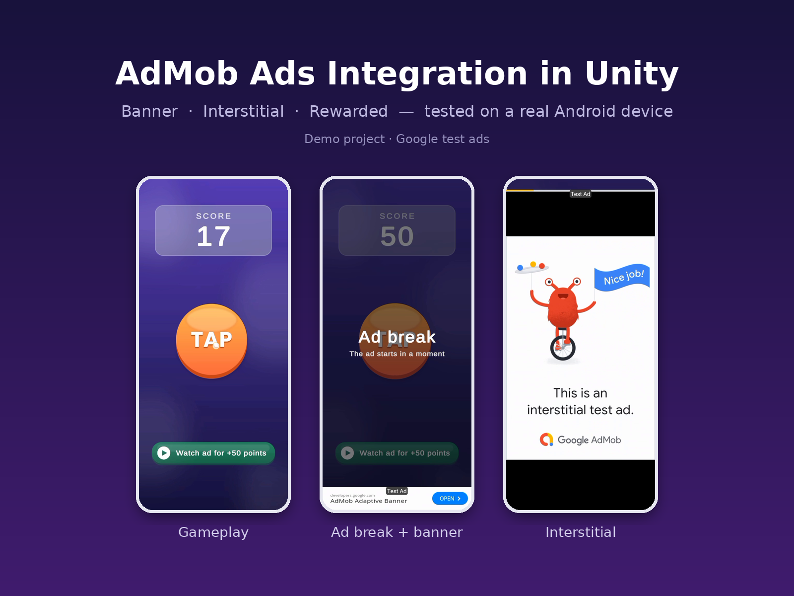
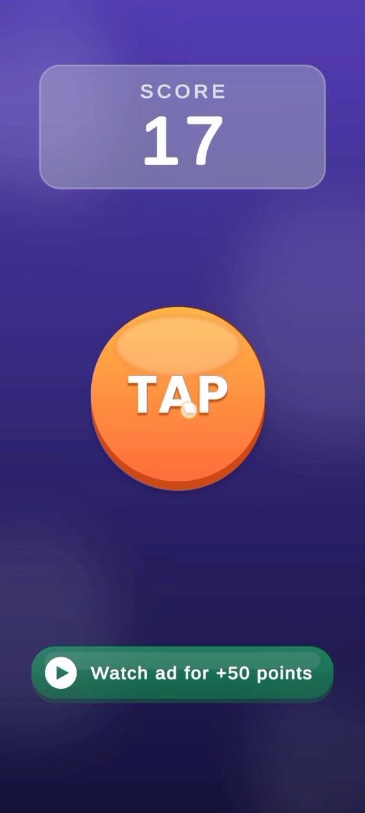
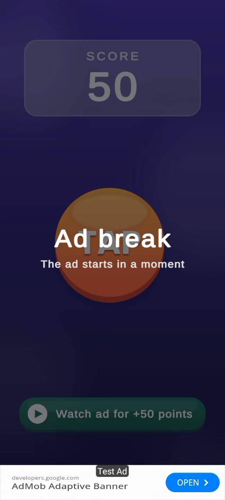
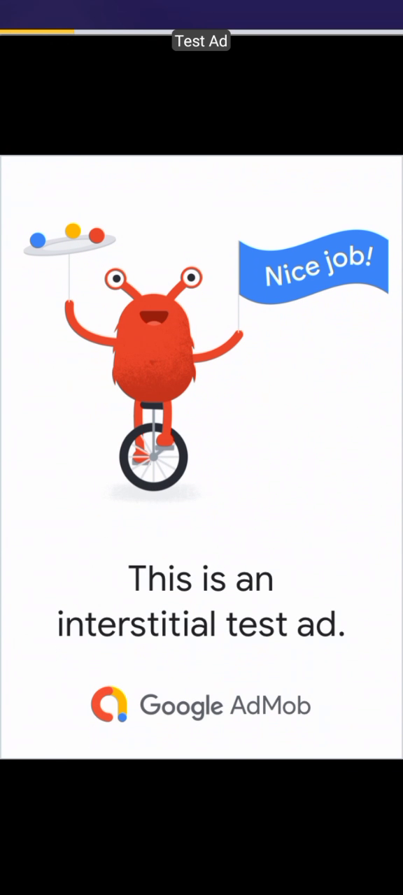

# AdMob Integration Demo (Unity)

A small Unity tap game that shows a clean, working **Google AdMob** integration for Android:
a **banner**, an **interstitial** and a **rewarded** ad, all tested on a real phone.

This is a demo project, built with Google's official **test** ad units.



▶ **[Watch the demo video](docs/demo.mp4)** (recorded on a real Android device)

## What it shows

| Ad type | How it works in the game |
|---|---|
| **Banner** | Anchored adaptive banner at the bottom; its size is chosen by Google for each device. |
| **Interstitial** | Shown every 10 taps. A short "Ad break" screen appears first and blocks taps, so a fast-tapping player doesn't tap the ad by accident. |
| **Rewarded** | "Watch ad for +50 points". The points are added only if the player earned the reward, and only after the ad has closed. Closing early gives nothing. The button stays greyed out until an ad is ready. |

## Details that matter in a real game

- **Main-thread safety:** every SDK callback is moved to Unity's main thread before it touches the score, UI or sound.
- **Preloading:** the next interstitial and rewarded ad start loading as soon as the previous one closes.
- **Retry with backoff:** if an ad fails to load, it retries after 5, 10, 20 and 40 seconds, then every 60 seconds. It never spams requests.
- **Safety check:** the game logs a warning if a real (non-test) ad unit is configured, because tapping your own real ads can get an AdMob account suspended.

| Gameplay | Ad break + banner | Interstitial |
|---|---|---|
|  |  |  |

## Tech

- Unity 6 (6000.6), C#
- Google Mobile Ads Unity plugin, with the External Dependency Manager for Android
- Android build

## Project structure

```
Assets/Scripts/
  AdsManager.cs   all ad logic: banner, interstitial, rewarded
  TapGame.cs      the tap game and score
  GameAudio.cs    sound effects
  Editor/AdMobDemoSetup.cs   editor helper that builds the demo scene
```

## Use it with your own ads

1. Replace the test App ID in **Assets → Google Mobile Ads → Settings** with your AdMob App ID.
2. Replace the three test ad unit IDs on the `AdsManager` component with your own.
3. While testing, keep the test IDs or register your phone as a test device. Never tap your own live ads.

---

Built by **Anas Afzal**, Unity developer. I integrate AdMob into Unity mobile games.
